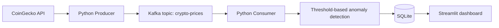

# Crypto Anomaly Tracker

Crypto Anomaly Tracker is a Python and Apache Kafka learning project. It collects Bitcoin, Ethereum, and Solana prices in USD and checks for large changes between consecutive observations.

## Architecture



- **CoinGecko API** provides the cryptocurrency price data.
- **Python producer** requests the latest prices and publishes a JSON message to Kafka about every 60 seconds.
- **Kafka** transports those messages through the `crypto-prices` topic.
- **Python consumer** reads the messages and compares each valid price with the previous observed price for that cryptocurrency.
- **Threshold detector** prints an anomaly when the absolute percentage change is greater than 2%.

The producer and consumer connect to Kafka at `localhost:9092`. The Docker Compose configuration runs a single Apache Kafka container with a plaintext listener for local development.

## Current features

- Fetches Bitcoin, Ethereum, and Solana prices in USD from CoinGecko.
- Repeats price collection at the 60-second delay configured in the producer.
- Publishes price data as JSON messages to the `crypto-prices` Kafka topic.
- Consumes price messages and maintains an in-memory baseline for each cryptocurrency.
- Calculates percentage changes between consecutive valid observations.
- Prints an anomaly when the absolute change is strictly greater than the configured 2% threshold; otherwise, it prints the change as normal.
- Skips prices that are non-numeric or not positive.
- Persists price observations and anomalies, including their data source, in SQLite.
- Displays latest prices, price history, and anomalies in a dashboard with a shared
  source filter for All sources, CoinGecko, Manual tests, and Unknown.
- Includes a small script that demonstrates the percentage-change calculation.

The baseline exists only in consumer memory. It is lost when the consumer stops, so the first valid observation after a restart sets a new baseline instead of being compared with a persisted price.

## Technology stack

- Python
- Apache Kafka
- Docker Compose
- CoinGecko API
- `requests`
- `kafka-python`

## Prerequisites

- Python and pip. The repository does not pin a Python version; Python 3.12 is a reasonable choice for this project and its dependencies.
- Docker Desktop with Docker Compose.
- Git.
- Internet access for requests to CoinGecko.

## Local setup

The following commands use PowerShell and the repository's `producer/requirements.txt`, which includes the dependencies needed to run both Python scripts. A root-level `requirements.txt` is also present with overlapping but different dependency pins; use one manifest rather than installing both into the same environment.

Clone the repository and create a virtual environment:

```powershell
git clone https://github.com/DanielC34/crypto-anomaly-detector.git
Set-Location .\crypto-anomaly-detector
python --version
python -m venv venv
.\venv\Scripts\Activate.ps1
python -m pip install -r producer\requirements.txt
```

Start Kafka from the repository root:

```powershell
docker compose -f docker\docker-compose.yml up -d
```

Wait for the Kafka container to finish starting. In this terminal, start the consumer:

```powershell
python consumer\consumer.py
```

Open a second PowerShell terminal in the parent directory where you cloned the repository, change to the repository directory, activate the same environment, and start the producer:

```powershell
Set-Location .\crypto-anomaly-detector
.\venv\Scripts\Activate.ps1
python producer\producer.py
```

Starting the consumer first is useful because its `auto_offset_reset="latest"` setting means a consumer group with no committed offset begins at the end of the topic. If the producer publishes before a new consumer group starts, that group will not read those earlier messages. With the consumer running first, it can receive the first price message and establish its in-memory baseline. The configured group ID is `crypto-anomaly-detector`; if that group already has a committed offset, Kafka resumes from that offset instead of applying the reset policy.

The dashboard requires `streamlit`, `pandas`, and `streamlit-autorefresh` in the active Python environment. From the repository root, run:

```powershell
streamlit run dashboard.py
```

The source filter applies to latest prices, price history, and recent anomalies. All sources is selected by default; a source with no matching rows displays an empty state.

To stop the processes cleanly:

1. Press **Ctrl+C** in the producer terminal.
2. Press **Ctrl+C** in the consumer terminal.
3. From the repository root, stop and remove the Kafka container:

   ```powershell
   docker compose -f docker\docker-compose.yml down
   ```

## Testing

Run the existing threshold demonstration from the repository root:

```powershell
python consumer\test_detector.py
```

It calculates the percentage change from `100,000` to `97,000` and prints the result (`-3.00%`) and whether its absolute value exceeds the script's `2.0` threshold (`True`). This is a demonstration script: it does not contain assertions and does not call the consumer's detection loop.

There are no automated tests for Kafka delivery, invalid input handling in the consumer, or end-to-end anomaly alerts. The demonstration should not be treated as a comprehensive test suite.

## Current limitations and future improvements

- The detector compares consecutive observations; it does not use a statistical model.
- A threshold alert indicates a price change larger than the configured percentage, not proof that the change is statistically unusual.
- Baselines are held only in memory and are reset when the consumer restarts.
- The dashboard is read-only and does not deliver alerts.
- Robust Kafka retry and reconnection behavior, along with automated integration tests, may need further work.

Potential future work includes more robust failure handling, integration tests, and alert delivery.

## Project structure

```text
.
├── consumer/
│   ├── consumer.py
│   └── test_detector.py
├── data/
├── dashboard.py
├── docker/
│   └── docker-compose.yml
├── producer/
│   ├── producer.py
│   └── requirements.txt
├── .gitignore
├── README.md
└── requirements.txt
```

No license file is currently included in the repository.
